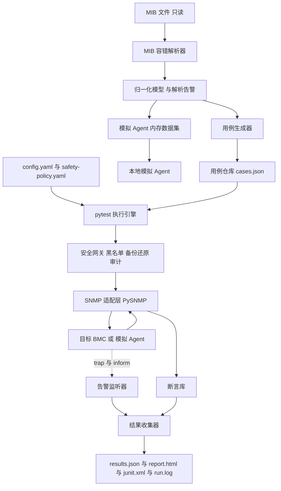

## 产品概述

面向 BMC SNMP 功能的自动化测试框架，以目录内提供的 MIB 文件为唯一输入，自动解析并生成可重复执行的测试用例，对目标设备的 OID 读写、数据类型、取值范围、访问权限、异常输入及告警上报进行验证，并输出可追溯的测试报告。支持多目标批量执行与用例管理；在未提供真实设备时，可通过本地模拟环境完成全流程自测。

## 核心 Features

- MIB 自动解析与用例生成：识别标量、表、枚举、范围与访问权限，产出带稳定编号的用例集。
- 操作与版本矩阵：GET / GETNEXT / GETBULK / SET 与 v1 / v2c / v3 的组合覆盖，含版本差异与错误语义校验。
- 正确性校验：OID 读写一致性、数据类型、取值范围、访问拒绝、异常输入的预期拒绝结果。
- trap / inform 校验：触发条件与上报内容（版本、来源、认证、级别、变量绑定、时序、确认机制）。
- 批量执行与用例管理：标签/版本/模块筛选、优先级、跳过与白名单、并发、失败重跑、试运行。
- 安全可回滚写入：默认禁用高危节点，写入前备份、写入后还原并留审计记录。
- 报告与可重复执行：通过率、失败详情、完整日志、运行标识与输入快照，历史产物不覆盖。
- 全参数可配置：目标地址、各版本认证参数、告警监听、安全策略、并发与报告路径。
- 本地模拟环境：无真实设备也能端到端跑通并产出示例报告。

## Tech Stack Selection

- 语言与运行时：Python 3.10.11（当前环境已验证），Windows / PowerShell 与 Linux 均可运行。
- SNMP 协议栈：PySNMP（用户指定）。采用其维护中的 asyncio API 分支并在 `requirements.txt` 锁定具体版本；若选用 4.4.x 同步分支，必须同时锁定 `pyasn1==0.4.8`（4.4.x 与 pyasn1 0.5+ 不兼容）。全部 PySNMP 调用集中在 `snmp/transport.py` 适配层，隔离版本 API 差异。
- 用例与执行：pytest（参数化、marker 筛选、`--lf` 失败重跑、hook 结果收集）；PyYAML 做配置与用例序列化；Jinja2 生成 HTML 报告；标准库 `logging`、`hashlib`、`argparse`、`dataclasses`、`concurrent.futures`。
- 不引入 Web 框架、数据库或消息中间件；报告为静态产物，凭据通过环境变量注入。

## Implementation Approach

采用「模型驱动 + 分层适配」流水线：容错解析 MIB 得到归一化模型，模型展开成稳定编号的用例仓库，pytest 执行引擎通过 SNMP 适配层与真实或模拟 Agent 交互，断言库与结果收集器产出多格式报告。

关键决策与权衡：

1. **自研容错解析器而非 pysmi**：该 MIB 模块名含连字符、71 处 `--` 注释定义、`Integer32{ normal(0),... }` 内联枚举、`Integer32 (1..65535)` 范围、无 SIZE 的 `OCTET STRING`、跨行 DESCRIPTION、tab/空格与 CRLF 混排，严格 SMI 解析器会失败或漏节点。解析分两遍：先剥离行注释（引号内不剥离）并按 `OBJECT IDENTIFIER`、`OBJECT-TYPE`、`SEQUENCE` 分块，再依据 `::= { 父名 数字 }` 迭代解析出数值 OID（根为 `enterprises 52305` → `1.3.6.1.4.1.52305`）；未解析父节点、异常语法记入 `parse-warnings.json` 并排除，不静默丢弃。
2. **用例即数据**：生成 `cases.json`，`case_id` 由 MIB 哈希 + OID + 操作 + 版本 + 类别派生，保证重复生成结果一致；表节点按列模板生成带索引占位符的用例并受 `max_cases_per_table` 限制，避免 43 张表 × 行的组合爆炸。
3. **无 NOTIFICATION-TYPE 的 trap 方案**：MIB 中 trap 定义数量为 0，仅有 `snmptrapPoliciesTable`（`alarmSetting 1`，16 列含 Enable / Version / Severity / Port / Community / AlertEnable1-4 / SnmpAddr1-4）、`emailalarmPoliciesTable`（`alarmSetting 2`）与 `eventLogsTable`（`serverAssetInfo 11`，含 EventID / TimeStamp / SensorName / SensorType / Description / EventType）。因此 trap/inform 期望放在 `config/trap-expectations.yaml`：配置目的端 → 由安全 SET 或模拟事件触发 → 本地监听接收 → 按标准 trap OID、企业 OID、变量绑定、严重级别、时序、inform 确认做断言。
4. **安全内建（防御纵深）**：生成期与执行期双重校验。默认黑名单含 `serverPowerStatusControl`（write-only 电源控制）、`addBmcUser` / `delBmcUser`、网络 IP 配置类 `IpAddress` 节点、删除会话节点；仅显式白名单加 `--allow-guarded` 才放行。SET 流程为 GET 备份 → SET → GET 校验 → `finally` 还原 → GET 复核；还原失败即把该目标剩余 SET 用例判为 ERROR 并中止，避免状态漂移。
5. **性能**：解析 O(L)（L 为行数，约 11k）；用例生成 O(N·V·K)（N 约 1100 有效节点，V=3，K 为每节点用例类别数）时间与空间，用 MIB 哈希缓存模型、用例仓库惰性加载。执行耗时由网络 RTT 主导：每「目标+版本」复用单一 SNMP Engine 与会话（避免逐用例握手/USM 引擎初始化），只读用例按 varbind 批量与信号量并发，表遍历用受限 `max-repetitions` 的 GETBULK 而非逐点 GETNEXT，SET 用例按目标串行化以防备份还原竞态。
6. **可靠性与可重复性**：统一超时/重试与归一化错误对象；`run_id` 目录保存脱敏配置快照、MIB SHA-256、用例集、`results.json`、`report.html`、`junit.xml`、`run.log`、`pdus.jsonl`；`--rerun` 以相同用例集复跑并与历史结果对比。凭据由 `CredentialMaskingFilter` 在日志与报告中脱敏。
7. **避免技术债**：仅新增必要的适配层与流水线分层，不引入额外架构模式；未来若需 net-snmp 后端，只需替换 `transport.py`，其余模块不动（YAGNI，暂不实现）。

## Architecture Design



数据流：解析 → 建模 → 生成 → 筛选 → 执行（安全网关 → 适配层 → 设备/模拟）→ 断言 → 聚合 → 报告；trap 通道与请求通道并行，由监听器写入同一结果收集器。

## Implementation Notes

- 热路径：禁止逐用例创建 SNMP Engine / 传输；只读用例批量合并 varbind（受 `max_varbinds` 限制），GETBULK 限制 `max-repetitions` 与超时；用例仓库按 MIB 哈希缓存、按筛选条件流式读取；表用例按列模板生成，避免为每行生成全量组合。
- 日志：复用标准 `logging`，`run.log` 记用例级结果，`pdus.jsonl` 记收发 PDU（可配置采样与轮转）；仅记录 OID、类型、错误状态与目标，团体字、v3 认证/加密密钥一律脱敏；避免逐 varbind 全量打印导致日志膨胀。
- 影响面控制：MIB 文件只读；新增文件全部位于 `d:/AI/SNMP` 下；默认 `mock` 模式不发起任何对外连接，绝不默认下发电源控制、用户增删、网络配置等状态变更命令；`config.example.yaml` 仅含占位符与环境变量引用；监听端口、并发数、报告目录均可配置，进程退出时关闭监听与模拟 Agent。
- 平台细节：使用 `pathlib` 处理 Windows 路径；读取 MIB 时按 UTF-8 并容错、统一 CRLF；Windows 上使用默认 Proactor 事件循环，不依赖 `fork`；UDP 监听地址与端口显式配置为本地地址。

## Directory Structure

```
d:/AI/SNMP/
├── TTY-T1ZDG-v1.0_20261026.mib          # [INPUT 只读] 唯一输入 MIB，11414 行，任何情况下不修改
├── requirements.txt                      # [NEW] 固定 pysnmp、pyasn1、pytest、PyYAML、Jinja2 版本，注明已验收组合
├── pyproject.toml                        # [NEW] 包元数据、pytest marker 注册、CLI 入口 snmp-test
├── README.md                             # [NEW] 安装、四个子命令、安全声明、目录与报告说明
├── docs/
│   └── snmp-test-design.md               # [NEW] 方案设计文档：架构、用例矩阵、解析容错规则、安全边界、trap 语义、报告规范
├── config/
│   ├── config.example.yaml               # [NEW] 多 target、v1/v2c 团体字、v3 USM 用户与协议密钥、超时重试、trap 监听、并发、报告目录
│   ├── safety-policy.yaml                # [NEW] 高危 OID 黑名单、显式白名单、SET 开关、备份还原与审计策略
│   └── trap-expectations.yaml            # [NEW] trap/inform 触发动作、期望 trap OID、企业 OID、varbind 类型与值、严重级别、时序与 ACK 断言
├── src/snmp_test/
│   ├── __init__.py                       # [NEW] 包初始化与版本信息
│   ├── cli.py                            # [NEW] argparse 子命令：generate、run、mock-agent、report；参数校验与退出码
│   ├── config.py                         # [NEW] 配置加载与校验、环境变量插值、多 target 展开、凭据脱敏
│   ├── model/
│   │   ├── types.py                      # [NEW] MibNode、SyntaxSpec、TestCase、CaseResult、TrapExpectation 数据结构
│   │   ├── mib_parser.py                 # [NEW] 两遍容错解析：注释剥离、分块、SYNTAX/枚举/范围/ACCESS/INDEX 提取
│   │   └── mib_model.py                  # [NEW] OID 树数值化、表与列及索引关联、MIB 哈希、模型序列化与 warning 汇总
│   ├── generator/
│   │   ├── value_factory.py              # [NEW] 由语法生成合法值、边界值、非法值（枚举、范围、字符串长度、类型错配）
│   │   ├── case_builder.py               # [NEW] 四操作乘三版本矩阵展开、稳定 case_id、tag 与期望断言、安全分级
│   │   └── trap_cases.py                 # [NEW] 由 trap-expectations.yaml 生成 trap/inform 用例与触发动作绑定
│   ├── snmp/
│   │   ├── transport.py                  # [NEW] PySNMP asyncio 适配与同步门面；按目标+版本复用 Engine；GET/GETNEXT/GETBULK/SET
│   │   ├── errors.py                     # [NEW] v1 错误状态与 v2c/v3 异常变量绑定归一化、超时与认证失败分类
│   │   ├── trap_listener.py              # [NEW] v1/v2c/v3 trap 与 inform 接收、inform ACK、有界环形缓冲与请求匹配
│   │   ├── triggers.py                   # [NEW] 事件触发适配器接口与安全 SET 实现；其他触发方式默认禁用并需显式开启
│   │   └── mock_agent.py                 # [NEW] 本地模拟 Agent：内存数据集、有序 OID 索引、四操作响应、按配置发送 trap/inform
│   ├── runner/
│   │   ├── case_store.py                 # [NEW] 用例加载、按 id/tag/版本/模块筛选、优先级、跳过、重跑集合固化
│   │   ├── safety.py                     # [NEW] 黑名单与白名单校验、SET 前备份与 finally 还原、审计日志、失败快速中止
│   │   ├── assertions.py                 # [NEW] 类型/范围/枚举/权限/错误码/OID 顺序/varbind/trap 内容断言与期望实际差异
│   │   ├── executor.py                   # [NEW] 批量调度、并发信号量、SET 按目标串行、重试、dry-run、generate-only
│   │   └── pytest_plugin.py              # [NEW] conftest 挂载：参数化用例、marker 映射、session 级会话/监听 fixtures、hook 结果收集
│   └── report/
│       ├── collector.py                  # [NEW] 聚合通过率（总体/版本/操作/模块）、失败明细与运行元数据
│       ├── writers.py                    # [NEW] 输出 results.json、report.html、junit.xml、run.log 索引，创建 run_id 目录与快照
│       └── templates/report.html.j2      # [NEW] 自包含 HTML 报告模板：汇总卡片、筛选表格、失败详情与日志片段
├── tests/
│   ├── conftest.py                       # [NEW] 注册 pytest_plugin、提供模拟 Agent 与会话 fixtures
│   ├── test_mib_parser.py                # [NEW] 基于真实 MIB 断言节点数量、根 OID、枚举/范围、表与索引、注释跳过、warning
│   ├── test_generator.py                 # [NEW] 断言矩阵覆盖、稳定 case_id、幂等重生成、黑名单分级
│   ├── test_assertions.py                # [NEW] 覆盖类型/范围/权限/错误码/trap 断言与 v1 与 v2c 差异
│   ├── test_safety.py                    # [NEW] 覆盖备份还原、还原失败中止、黑名单拦截、凭据脱敏
│   └── test_e2e_mock_agent.py            # [NEW] 本地模拟 Agent 端到端：四操作乘三版本、trap/inform、报告产出与 rerun 一致性
├── cases/generated/                      # [生成目录] model.json、cases.json、parse-warnings.json，由 generate 产出
└── runs/                                 # [生成目录] runs/{run_id}/ 下保存结果、报告、日志与脱敏配置快照
```

## Key Code Structures

```python
# src/snmp_test/model/types.py —— 解析层与用例层共享的核心数据结构（仅接口定义）
@dataclass(frozen=True)
class SyntaxSpec:
    base_type: str                          # Integer32 | OCTET STRING | DisplayString | IpAddress | ...
    enum: dict[str, int] | None = None      # 内联枚举，如 normal(0), abnormal(1), absent(2)
    ranges: tuple[tuple[int, int], ...] = ()
    size: tuple[int, int] | None = None

@dataclass(frozen=True)
class MibNode:
    name: str
    oid: str                                # 数值 OID，如 1.3.6.1.4.1.52305.3.13.1.1.2.1
    kind: str                               # scalar | table | entry | column | group
    access: str                             # read-only | read-write | write-only | not-accessible
    syntax: SyntaxSpec | None
    index_names: tuple[str, ...] = ()
    table_name: str | None = None
    source_line: int = 0
    warnings: tuple[str, ...] = ()

@dataclass(frozen=True)
class TestCase:
    case_id: str                            # 由 mib_hash + oid + operation + version + category 派生，稳定唯一
    oid: str
    operation: str                          # GET | GETNEXT | GETBULK | SET | TRAP | INFORM
    version: str                            # v1 | v2c | v3
    category: str                           # normal | boundary | type | access | invalid | trap
    tags: tuple[str, ...]
    payload: dict                           # value、max_repetitions、varbinds、trigger 等
    expectation: dict                       # 期望类型、范围、枚举、错误状态、varbind 与 trap 内容
    safety: str                             # safe | guarded | blocked
```

## Agent Extensions

### Skill

- **ipmi2-spec**
- Purpose: 为该 BMC MIB 中无 NOTIFICATION-TYPE 的告警校验提供 IPMI 2.0 依据，梳理 PEF/SEL 事件、告警策略、事件 ID 与传感器严重级别到 SNMP trap/inform 变量绑定的映射，并明确只读、不触发状态变更的安全触发方式。
- Expected outcome: 形成 `config/trap-expectations.yaml` 的触发条件与内容期望规范，以及 `docs/snmp-test-design.md` 中的 trap 语义章节，字段与 IPMI 2.0 定义一致且不含任何状态变更命令。

### SubAgent

- **code-explorer**
- Purpose: 以「very thorough」级别全量扫描 11414 行 MIB，盘点所有 SYNTAX 变体、MAX-ACCESS 取值、OID 赋值形式、表/INDEX/SEQUENCE 结构、`--` 注释定义与异常拼写，供解析器规则设计与覆盖率校验。
- Expected outcome: 产出带行号的语法变体清单与节点统计基线，用于 `tests/test_mib_parser.py` 的解析完整性断言，确保无节点遗漏与 OID 编号错位。