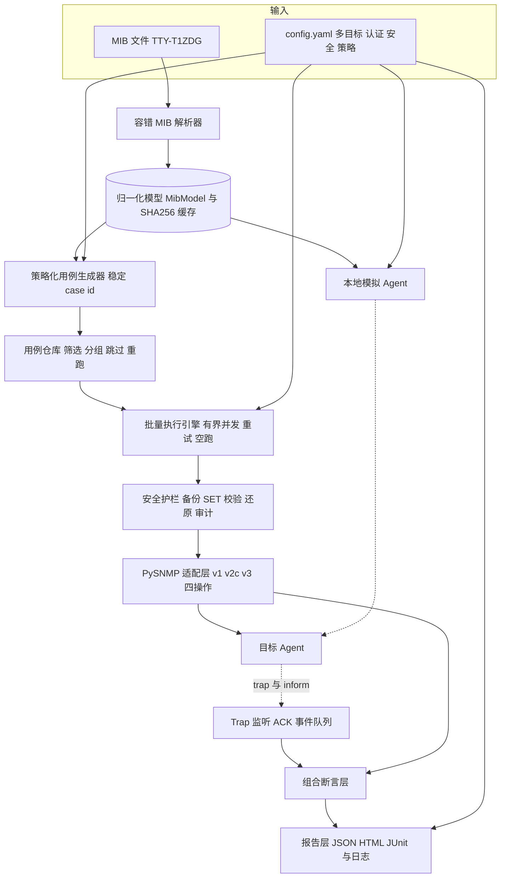

## 用户要求

基于目录内已提供的 MIB 文件，设计并实现一套 BMC SNMP 功能自动化测试方案，交付**可运行的测试框架 + 方案文档**。方案以 MIB 为唯一用例来源自动生成用例，覆盖全部操作与协议版本，校验读写、数据类型、取值范围、访问权限、异常输入及告警上报，支持批量执行、用例管理、结果断言与可复现的测试报告；目标地址、认证参数与执行策略均可配置，且在**不连接真实 BMC** 的前提下通过本地模拟目标完成端到端自测。

## 产品概述

面向 BMC 带外管理 SNMP 接口的回归与验收测试工具，主线为「解析 → 生成 → 执行 → 断言 → 报告」。将 MIB 中定义的所有对象（含标量、表、列、索引、枚举、范围、访问权限、告警策略节点）转换为带稳定编号、可筛选、可重复执行的用例集。默认以本地模拟目标运行，切换配置即可对接真实设备；SET 采用安全可回滚策略（先备份、测后还原），状态变更类对象默认禁用并全程审计。视觉上以清晰的结构化报告呈现：总体与分维度通过率、失败用例的期望与实际对照、可折叠的请求与响应日志。

## 核心功能

- **MIB 自动解析与用例生成**：识别对象、数值 OID、数据类型、枚举与范围、访问权限、表与索引及告警策略节点，生成带稳定编号的用例集，重复生成结果一致。
- **全矩阵协议覆盖**：GET / GETNEXT / GETBULK / SET × v1 / v2c / v3，含各版本能力差异与错误语义的期望校验。
- **数据与权限校验**：OID 读写、ASN.1 数据类型、枚举与取值范围、只读/读写/只写/不可访问、错误团体字与错误认证参数，以及非法 OID、越界值、超长字符串、类型错误等异常输入。
- **Trap / Inform 校验**：按触发条件配置目的端并被动接收，校验版本、来源、Trap 标识、变量绑定内容与类型、严重级别、时序、重复与确认。
- **安全可回滚 SET**：仅对配置类可写对象执行，先备份后还原；状态变更类对象默认黑名单、需显式授权；全程审计记录。
- **批量执行与用例管理**：按编号/标签/版本/操作/优先级筛选、跳过与白名单、并发与串行控制、超时重试、失败重跑、空跑预览。
- **报告与可复现性**：通过率统计、失败详情、完整收发日志、运行隔离与配置快照、凭据脱敏；多次执行结果不互相覆盖。

## Tech Stack Selection

- **语言与运行时**：Python 3.10.11（已确认），Windows / PowerShell，路径统一使用 `pathlib`。
- **协议栈**：PySNMP（用户指定）。决策：固定 `pysnmp==4.4.12` + `pyasn1==0.4.8` + `pycryptodomex`，因其同步 hlapi 对 v1/v2c/v3 的 GET/GETNEXT/GETBULK/SET 与 trap/inform 支持成熟、示例丰富，且同步模型天然适配 pytest 与线程池批量执行；代价是该分支较旧，因此**所有 PySNMP 调用收敛到唯一适配层 `snmp_test/client/snmp_client.py`**，未来迁移到 lextudio pysnmp 6/7（asyncio）只需改这一模块。
- **用例与断言**：pytest（已安装）、PyYAML（已安装）；报告模板用 Jinja2；JUnit XML 用标准库 `xml.etree.ElementTree`。
- **标准库**：`argparse`、`logging`、`hashlib`、`json`、`re`、`dataclasses`、`concurrent.futures`、`threading`、`socket`。
- **不引入** Web 框架、数据库、消息队列：报告为自包含静态文件，trap 事件用线程安全队列即可，避免不必要依赖与部署开销。

## Implementation Approach

**策略**：模型驱动的分层流水线。容错解析器把 MIB 一次性解析为归一化模型（含数值 OID 树、语法约束、访问权限、表关系、告警策略）并按 MIB 摘要缓存；策略模板由模型生成稳定编号的用例；执行引擎经安全护栏与 PySNMP 适配层批量下发；组合断言层统一判定；报告层聚合输出。配套由同一模型驱动的本地模拟 Agent，实现无真实 BMC 的离线端到端自测。

**关键技术决策与取舍**：

1. **自研容错解析器，而非 pysmi 等严格 SMI 解析器**：该 MIB 模块名含连字符（`TTY-T4XDG-v1-4-MIB`）、存在 `Integer32{ normal(0), ... }` 内联枚举、`Integer32 (1..65535)` 范围、`--` 注释掉的 71 处定义、跨行且形态不一的 DESCRIPTION、以及 `XxxEntry ::=` 与 `SEQUENCE {` 分行等写法，严格解析器极可能整体失败。自研「按行归一化 + 状态机」解析器可控、可记录 warning、可单测锁定；代价是需覆盖非标准变体，用回归测试与变体清单约束。
2. **PySNMP 适配层 + 归一化响应**：上层只依赖 `SnmpResponse`（变量绑定的 ASN.1 类型标签、值、错误状态、异常标记），将 v1/v2c/v3 差异与版本迁移风险隔离在单一模块，符合 SoC 与 DRY。
3. **稳定 case id + 模型缓存**：`id = sha1(节点名|数值OID|操作|版本|类别)`，保证可重复执行、支持按 id 精确重跑与生成结果可 diff；解析结果按 MIB SHA-256 缓存，避免每次运行重复扫描 11414 行。
4. **用例规模控制**：活跃对象约 1100 个，全笛卡尔积（4 操作 × 3 版本 × 多校验维度）可达数万条。采用「策略模板 + 采样/上限 + 表列按运行时索引懒展开」：表索引通过一次 GETBULK walk 发现，避免 N+1 次 GET；默认生成代表性集合，配置可切 `full`。
5. **安全默认拒绝**：SET 仅面向配置类 read-write 节点；电源控制、用户增删、网络 IP 等状态变更节点写入默认黑名单；「GET 备份 → SET → GET 校验 → finally 还原 → 再 GET 确认」为原子流程并全量审计；trap 以被动监听为主，触发仅使用安全事件。
6. **并发模型**：只读用例按目标有界并行，SET 用例按目标串行化避免状态竞争；trap 监听单线程常驻 + 线程安全队列，按 run/case 关联事件。

**性能与可靠性**：解析 O(L)（L≈11414 行）一次完成，OID 解析多遍 O(N) 字典查找；生成 O(N×S) 且受配置上限约束；执行瓶颈是网络 RTT，缓解手段为合并变量绑定、GETBULK 表遍历、按 target+version 复用 SnmpEngine/上下文、有界线程池、超时重试；报告流式聚合并截断 PDU 摘要，避免大对象常驻内存；批量用例日志采样限流，防日志风暴。

**避免技术债**：复用已安装的 pytest/PyYAML 与标准库，不新增架构模式；新增依赖仅 PySNMP 体系与 Jinja2；所有共享契约集中在 `model.py`，避免各处各自解析 OID 字符串。

## Implementation Notes（执行要点）

- **解析容错（已验证事实）**：必须跳过以 `--` 开头的定义且不影响 `::= { parent n }` 的编号连续性；模块名含连字符不得做标识符合法性校验；`--xxx start/end` 为分段注释；`INDEX {}` 与 `SEQUENCE {}` 均有单行与跨行两种形态；`diabled(0)`、`waring(2)`、`EnginedId` 等拼写错误原样保留；根为 `1.3.6.1.4.1.52305`，7 个一级子树；全库 0 个 NOTIFICATION-TYPE。
- **版本差异映射**：v1 不支持 GETBULK（生成时标注「预期不支持/跳过」）且无 Counter64；v1 错误用 `noSuchName`/`badValue`/`tooBig`，v2c/v3 用 `noSuchObject`/`noSuchInstance`/`endOfMibView` 异常绑定；v3 错误用户/认证/加密参数应表现为超时或报告级错误，绝不可判为成功。
- **Trap 设计前提**：MIB 无 notification 定义，仅有 `snmptrapPoliciesTable`（`alarmSetting 1`，16 列含 Enable/Version/Severity/Port/Community/EnginedId/AlertEnable1-4/SnmpAddr1-4）与 `emailalarmPoliciesTable`（`alarmSetting 2`）、`eventLogsTable`。因此触发条件基于告警策略配置 + 标准 trap OID + BMC 事件机制，用 `[skill:ipmi2-spec]` 梳理规范后落入 `docs/DESIGN.md` 与 trap 策略。
- **日志**：复用标准库 logging 并按 run 落盘；团体字、v3 密钥、PDU 中的敏感值统一脱敏；PDU 摘要限长；错误日志必须带 case id、目标、OID、错误状态以便定位。
- **影响范围控制**：不改动 MIB 源文件；所有新文件限定在 `d:/AI/SNMP/` 下；配置模板默认指向 `127.0.0.1` 的本地模拟 Agent，默认不连真实设备；报告按 `run_id` 目录隔离、不覆盖历史；无历史包袱，无需兼容层。
- **Windows 细节**：统一处理 CRLF 与 tab/空格混排；trap 监听显式绑定地址与端口；README 给出 PowerShell 命令示例。

## Architecture Design

新项目，采用**分层 + 流水线**架构，模块间通过 `model.py` 的不可变数据契约解耦，单向依赖，禁止反向调用：

- **模型层** `mib/`：lexer 归一化 → parser 状态机提取 → syntax 解析约束 → resolver 多遍解析数值 OID 树 → 缓存 `MibModel`。
- **生成层** `generator/`：策略模板 × 版本矩阵 → 稳定编号用例 JSON → 用例仓库（筛选/分组/跳过/重跑）。
- **执行层** `client/`（PySNMP 适配、trap 监听）+ `engine/`（runner、safety、trap_flow）+ `mock/`（离线 Agent）。
- **判定层** `assertions/`：值/协议/权限/trap 四类可组合断言，统一输出期望与实际 diff。
- **输出层** `report/`：JSON、自包含 HTML（通过率卡片、按版本/操作/模块统计、失败详情表、可折叠收发日志、配置快照与 MIB 摘要）、JUnit XML、每 run 日志。
- **入口** `cli.py`：`generate | run | mock-agent | report` 四个子命令；`config/` 提供多目标、认证、安全、生成与报告配置。



## Directory Structure Summary

全新空项目（当前仅有 `TTY-T1ZDG-v1.0_20261026.mib`）。以下为需创建的全部文件，按「基础 / 解析 / 生成 / 执行 / 判定 / 输出 / 测试」分组，输入 MIB 保持不动。

```
d:/AI/SNMP/
├── TTY-T1ZDG-v1.0_20261026.mib          # [EXISTING] 唯一输入，11414 行，禁止改动
├── requirements.txt                      # [NEW] 固定版本：pysnmp==4.4.12、pyasn1==0.4.8、pycryptodomex、pytest、PyYAML、Jinja2；注明兼容约束
├── pytest.ini                            # [NEW] pytest 配置：testpaths、markers（v1/v2c/v3、get/set/trap、safe/guarded）、日志级别
├── README.md                             # [NEW] 快速开始、四条 CLI 命令、配置字段说明、安全策略与 PowerShell 示例
├── docs/
│   └── DESIGN.md                         # [NEW] 方案文档：架构与数据流、用例矩阵、MIB 适配说明、版本差异表、trap 触发与内容断言规范、报告规范、扩展指南
├── config/
│   ├── config.example.yaml               # [NEW] 完整配置模板：多 target、v1/v2c 只读与读写团体字、v3 USM（用户/auth/priv/安全级别/engineId）、超时重试、trap 监听地址端口、生成策略与上限、筛选、并发、报告目录；默认指向 127.0.0.1
│   └── safety_policy.yaml                # [NEW] 默认黑名单（serverPowerStatusControl、addBmcUser、delBmcUser、网络 IP 列等）与空白名单样例、授权开关说明
├── snmp_test/
│   ├── __init__.py                       # [NEW] 包版本与公共导出
│   ├── cli.py                            # [NEW] argparse 入口：generate/run/mock-agent/report，参数校验与退出码
│   ├── model.py                          # [NEW] 全局不可变契约：SyntaxSpec、MibNode、MibModel、SnmpResponse、TestCase、CaseResult、AssertionResult、Version 枚举
│   ├── config.py                         # [NEW] YAML 加载、字段校验、多目标归一化、凭据脱敏、配置快照与摘要
│   ├── mib/
│   │   ├── __init__.py                   # [NEW]
│   │   ├── lexer.py                      # [NEW] 剥离 -- 注释（保留行号）、CRLF/tab 归一化、跨行 DESCRIPTION 与引号状态处理、分段注释识别
│   │   ├── parser.py                     # [NEW] 容错状态机：提取 OBJECT IDENTIFIER、OBJECT-TYPE、SEQUENCE、IMPORTS、INDEX、MAX-ACCESS、STATUS、::= {parent n}；跳过注释定义；收集 warning
│   │   ├── syntax.py                     # [NEW] SYNTAX 解析：基类型（Integer32/OCTET STRING/DisplayString/IpAddress/PhysAddress）、内联枚举、多行枚举、(1..65535) 范围、SIZE、SEQUENCE OF 引用
│   │   └── resolver.py                   # [NEW] 多遍解析父引用得到数值 OID 树，构建 by_oid 索引、表/行/列关系，按 MIB SHA-256 读写 JSON 缓存
│   ├── generator/
│   │   ├── __init__.py                   # [NEW]
│   │   ├── strategies.py                 # [NEW] 各操作 × 版本 × 维度的用例模板：存在性/类型/枚举范围/值、GETNEXT 顺序与边界、GETBULK 参数、SET 合法与非法值、访问权限、异常输入、v3 认证矩阵、trap 触发
│   │   ├── generator.py                  # [NEW] 调用策略生成稳定 id、标签、优先级、期望断言、safety_class；实现采样与数量上限；表列懒展开标记
│   │   └── case_registry.py              # [NEW] 用例持久化 cases/*.json、按 id/tag/版本/操作/优先级筛选、跳过与白名单、失败重跑集合、确定性排序
│   ├── client/
│   │   ├── __init__.py                   # [NEW]
│   │   ├── snmp_client.py                # [NEW] 唯一耦合 PySNMP 的模块：SnmpEngine/CommunityData/UsmUserData 构建，get/getnext/getbulk/set 与重试超时，target+version 上下文复用
│   │   ├── response.py                   # [NEW] 原始 PDU 归一化：varbind 的 OID、ASN.1 类型标签、值、异常标记、错误状态/索引；v1 与 v2c/v3 差异归一
│   │   └── trap_listener.py              # [NEW] 绑定 UDP 接收 v1 trap 与 v2c/v3 trap/inform、发送 inform ACK、线程安全事件队列、按 run/case 关联、超时关闭
│   ├── engine/
│   │   ├── __init__.py                   # [NEW]
│   │   ├── runner.py                     # [NEW] 批量执行：按目标分组、只读有界并发与 SET 串行化、超时重试、dry-run、表索引一次 walk 发现、逐例记录请求与响应
│   │   ├── safety.py                     # [NEW] 黑名单/白名单强制校验（默认拒绝）、GET 备份到 SET 到 GET 校验到 finally 还原到再确认、审计日志、任何异常都保证还原
│   │   └── trap_flow.py                  # [NEW] 触发条件编排：安全配置目的端、触发事件、等待窗口、事件收集与关联、重复/丢失判定、inform ACK 校验
│   ├── assertions/
│   │   ├── __init__.py                   # [NEW]
│   │   ├── base.py                       # [NEW] AssertionResult 与期望/实际 diff、断言注册与执行器
│   │   ├── value.py                      # [NEW] 类型标签、值相等、枚举集合、(1..65535) 范围、SIZE、DisplayString 长度断言
│   │   ├── protocol.py                   # [NEW] GETNEXT 字典序、GETBULK 数量与重复数、endOfMibView、错误状态映射、只读/只写/不可访问的拒绝断言、错误团体字与错误 v3 参数断言
│   │   └── trap.py                       # [NEW] trap/inform 版本与来源、enterprise 与 trap OID、varbind OID/类型/值、严重级别、时序窗口、重复与丢失、ACK 断言
│   ├── report/
│   │   ├── __init__.py                   # [NEW]
│   │   ├── collector.py                  # [NEW] 结果聚合：总体与按版本/操作/模块/safety_class 的通过率、失败与跳过明细、耗时统计
│   │   ├── json_report.py                # [NEW] 机器可读全量结果，含 run_id、配置快照、MIB SHA-256、逐例断言与日志引用
│   │   ├── junit_xml.py                  # [NEW] JUnit XML，供 CI 消费
│   │   ├── html_report.py                # [NEW] 用 Jinja2 渲染自包含 HTML：通过率概览卡片、分维度统计表、失败用例期望与实际对照、可折叠收发日志、配置与 MIB 摘要
│   │   └── templates/report.html.j2      # [NEW] 报告模板（内联 CSS，无外部资源，便于归档与离线查看）
│   ├── mock/
│   │   ├── __init__.py                   # [NEW]
│   │   ├── datastore.py                  # [NEW] 由 MibModel 生成带类型的内存数据集（标量与表行种子值、枚举合法值、范围边界），SET 时执行类型/范围/权限校验
│   │   └── agent.py                      # [NEW] PySNMP CommandResponder + NotificationOriginator：v1/v2c/v3、四操作正确响应与错误状态、按触发 OID 发送 trap/inform
│   ├── trap_catalog.py                   # [NEW] 标准 trap OID、告警策略列与严重级别映射、触发条件清单的集中定义
│   └── util/
│       ├── __init__.py                   # [NEW]
│       └── logging.py                    # [NEW] 结构化日志、按 run_id 落盘、凭据脱敏、PDU 摘要限长、批量用例采样限流
├── cases/                                # [NEW] 生成产物目录（generated/*.json），含 .gitkeep
├── reports/                              # [NEW] 运行产物根目录，按 run_id 子目录隔离，含 .gitkeep
└── tests/
    ├── conftest.py                       # [NEW] fixtures：真实 MIB 路径、解析模型、示例配置、临时 reports 目录、本地模拟 Agent 进程
    ├── test_parser.py                    # [NEW] 断言解析统计（约 1202 处 OBJECT-TYPE 含注释、43 表、174 读写、8 只写、0 notification、71 注释定义被跳过）、根 OID 与若干节点数值 OID、warning 可控
    ├── test_syntax.py                    # [NEW] 内联/多行枚举、(1..65535) 范围、无 SIZE 的 OCTET STRING、IpAddress、SEQUENCE OF 与 INDEX 单行/跨行变体
    ├── test_generator.py                 # [NEW] 稳定 case id、同输入同输出、四操作 × 三版本矩阵覆盖、上限与筛选、表懒展开标记
    ├── test_assertions.py                # [NEW] 类型/范围/顺序/错误状态/权限断言与期望实际 diff
    ├── test_safety.py                    # [NEW] 黑名单默认拒绝、SET 异常时仍还原、审计记录完整、dry-run 不下发
    └── test_e2e_mock.py                  # [NEW] 启动本地模拟 Agent，跑通 v1/v2c/v3 的 GET/GETNEXT/GETBULK/SET 与 trap/inform，校验 JSON/HTML/JUnit 产物与通过率统计
```

## Key Code Structures

以下为跨模块共享的核心契约（仅接口级定义，无实现体），集中放于 `snmp_test/model.py`。

```python
# 解析产物：唯一事实来源，供生成器、断言、模拟 Agent 共用
@dataclass(frozen=True)
class SyntaxSpec:
    base_type: str                                  # Integer32 | OCTET STRING | DisplayString | IpAddress | ...
    enum: dict[int, str] = field(default_factory=dict)      # {0: "normal", 1: "abnormal", 2: "absent"}
    ranges: list[tuple[int, int]] = field(default_factory=list)   # [(1, 65535)]
    size: tuple[int, int] | None = None             # SIZE 约束
    ref: str | None = None                          # SEQUENCE OF / Entry 引用

@dataclass(frozen=True)
class MibNode:
    name: str
    oid: tuple[int, ...]                            # 如 (1, 3, 6, 1, 4, 1, 52305, 1, 1)
    kind: str                                       # scalar | table | entry | column | node
    syntax: SyntaxSpec | None
    access: str                                     # read-only | read-write | write-only | not-accessible
    index: tuple[str, ...] = ()
    parent: str = ""
    source_line: int = 0

@dataclass(frozen=True)
class MibModel:
    root_oid: tuple[int, ...]
    nodes: dict[str, MibNode]
    by_oid: dict[tuple[int, ...], str]
    warnings: list[str]
    mib_sha256: str
```

```python
# PySNMP 适配层契约：其余任何模块不得直接 import pysnmp
class SnmpClient(Protocol):
    def get(self, oids: Sequence[str], version: Version) -> "SnmpResponse": ...
    def get_next(self, oids: Sequence[str], version: Version) -> "SnmpResponse": ...
    def get_bulk(self, oids: Sequence[str], version: Version,
                 non_repeaters: int, max_repetitions: int) -> "SnmpResponse": ...
    def set(self, varbinds: Sequence[tuple[str, str, object]],
            version: Version) -> "SnmpResponse": ...

@dataclass(frozen=True)
class SnmpResponse:
    varbinds: list["VarBind"]      # oid, asn1_tag, value, exception_marker
    error_status: str              # noError | noSuchName | tooBig | ... 或异常绑定标记
    error_index: int
    raw_summary: str               # 脱敏且限长的 PDU 摘要，仅用于日志
    elapsed_ms: float
```

```python
# 生成器 → 执行引擎 → 报告 之间的用例与结果契约
@dataclass(frozen=True)
class TestCase:
    id: str                        # sha1(name | oid | operation | version | category)
    category: str                  # get | getnext | getbulk | set | access | exception | trap
    version: Version
    operation: str
    oid: str
    payload: dict                  # value / type / non_repeaters / max_repetitions ...
    expectations: list[dict]       # 断言名 + 参数
    tags: tuple[str, ...]
    priority: int
    safety_class: str              # safe | guarded | forbidden

@dataclass
class CaseResult:
    case_id: str
    status: str                    # passed | failed | skipped | error
    assertions: list[AssertionResult]   # name, expected, actual, passed, message
    request_log: str
    response_log: str
    duration_ms: float
    target: str
```

## Agent Extensions

### SubAgent

- **code-explorer**
- Purpose: 对 11414 行、278K 字符的 MIB 做 `very thorough` 结构普查，穷举所有 SYNTAX 变体（内联/多行枚举、范围、无 SIZE 字符串、IpAddress、SEQUENCE OF）、MAX-ACCESS、表/行/列与 INDEX 单行及跨行写法、被 `--` 注释定义、分段注释与拼写异常。
- Expected outcome: 产出一份带行号样例的「MIB 语法变体清单」，直接驱动 `mib/lexer.py`、`parser.py`、`syntax.py` 的实现与 `tests/test_parser.py`、`test_syntax.py` 的夹具，确保解析器无遗漏。

### Skill

- **ipmi2-spec**
- Purpose: 针对「MIB 中无 NOTIFICATION-TYPE」的缺口，查阅 IPMI 2.0 中 PEF/告警策略、SEL 事件、传感器事件与告警目的地机制，为 trap/inform 的触发条件与变量绑定内容提供规范依据。
- Expected outcome: 在 `docs/DESIGN.md` 中形成「trap/inform 触发条件与内容断言规范」（可安全触发的事件、标准 trap OID、varbind 组成、严重级别映射），并落到 `snmp_test/trap_catalog.py` 与 trap 用例策略中。