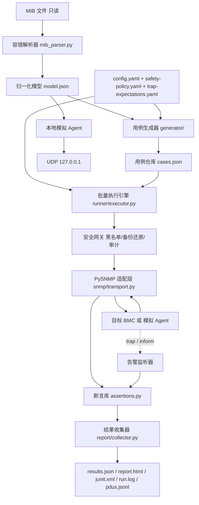

# bmc-snmp-testkit 方案设计

版本 1.0 · 适用输入：`TTY-T1ZDG-v1.0_20261026.mib`

> 本文回答「为什么这样设计」。若想搞清楚一次运行**实际读了什么、发了什么、凭什么判通过、去哪里核对**，以及当前真实环境接入的边界，请读配套的 [`docs/how-it-works.md`](how-it-works.md)（白盒说明）。

---

## 1. 目标与范围

以单份 MIB 为唯一输入，自动生成并执行 BMC SNMP 测试用例，覆盖：

- 操作：`GET / GETNEXT / GETBULK / SET`；
- 协议版本：`SNMP v1 / v2c / v3`（v3 含 USM 认证与加密）；
- 校验维度：OID 读写一致性、ASN.1 数据类型、取值范围与枚举、访问权限、异常输入处理；
- 通知校验：trap / inform 的触发条件与上报内容；
- 工程能力：批量执行、用例管理、结果断言、报告、全参数可配置、可重复执行。

**不在范围内**：不修改 MIB；不默认连接真实 BMC；不下发电源控制、用户增删、IP 变更等状态变更命令；不实现 Redfish/IPMI 命令下发。

---

## 2. 输入 MIB 分析

### 2.1 结构基线

| 项 | 值 |
| --- | --- |
| 文件行数 | 11414 |
| 模块名 | `TTY-T4XDG-v1-4-MIB`（含连字符，与文件名不一致） |
| 企业根 | `ttyRoot ::= {enterprises 52305}` → `1.3.6.1.4.1.52305` |
| 有效 OBJECT-TYPE | 1130 |
| OBJECT IDENTIFIER | 29（另有 9 处被注释） |
| 表 / 行 / 列 / 标量 | 39 / 39 / 941 / 111 |
| MAX-ACCESS | read-only 940、read-write 137、write-only 7、not-accessible 46 |
| 被注释定义 | 71 个 OBJECT-TYPE、9 个 OBJECT IDENTIFIER、4 张整表 |
| 内联枚举块 | 91 |
| `NOTIFICATION-TYPE` / `TRAP-TYPE` | **0** |
| trap 配置 | `snmptrapPoliciesTable`（`alarmSetting 1`，16 列）、`emailalarmPoliciesTable`（`alarmSetting 2`）、`eventLogsTable`（`serverAssetInfo 11`，7 列） |

### 2.2 为什么不采用 pysmi

该 MIB 不是严格 SMIv2：

1. 模块名含连字符，且 `IMPORTS` 混用 SMIv1 模块（RFC1155-SMI / RFC1213-MIB）；
2. 无 `MODULE-IDENTITY`、无 `OBJECT-GROUP` / `NOTIFICATION-GROUP` / `MODULE-COMPLIANCE`；
3. `SYNTAX Integer32{ normal(0), abnormal(1), absent(2) }` 内联枚举（合法写法应为 `INTEGER {...}`），共 91 处，其中 42 处 `{` 单独占行、1 处 `Integer32 (` 同行但 `}` 跨行；
4. 范围写法 `SYNTAX Integer32 (1..65535)`（`authPort`），与枚举写法混用；
5. `OCTET STRING` / `DisplayString` 多数无 `SIZE`；`IpAddress` 3 处；
6. `DESCRIPTION` 有 661 处 `""`、37 处单行字符串、432 处跨 3 行的引号块；
7. tab/空格/CRLF 混排，注释 `--` 共 899 行，其中 71 个注释定义仍包含完整的 `SYNTAX / MAX-ACCESS / DESCRIPTION / ::=` 文本；
8. OID 编号**不连续且存在重复**（编号 2、10 等被注释；注释块与有效节点重复占用同一子编号）；
9. 拼写异常：`diabled(0)`、`waring(2)`、`EnginedId`、`present-nondetected(0)`、`raidStorge*` 等；有节点名为 `raidLogicalInfoBadBlocksTable` 但实为**列**。

严格编译器会失败或漏节点；按行正则则会把注释定义计入（约多 10%）。故采用**自研容错解析器**。

---

## 3. 总体架构



分层原则：

- **解析层**与**用例层**输出纯数据（JSON/YAML），不依赖设备；
- **协议层**只在 `snmp/transport.py` 触摸 PySNMP，未来替换 net-snmp 后端不影响其他模块；
- **执行层**通过 `SnmpSession` 接口取会话，与安全网关解耦；
- **断言层**只消费 `TestCase.expectation`、`SnmpResponse`、`TrapRecord`，批量 CLI 与 pytest 桥接共用。

---

## 4. MIB 容错解析

### 4.1 两遍流程

**第一遍：注释剥离 + 分块**

- 逐行扫描，行首 `--` 整行丢弃并计入注释统计；行内 `--` 在引号外才截断；
- 跨行 `DESCRIPTION` 需要维护 `in_quote` 状态；注释行**不参与**状态更新，避免注释块中的 `-- "` 污染引号配对；
- 保留原始行号，用于告警与可追溯性。

**第二遍：定义块状态机**

按以下起始模式切块，块内聚合字段：

| 起始 | 结束条件 | 解析内容 |
| --- | --- | --- |
| `name OBJECT-TYPE` | `::= { parent N }` | SYNTAX、MAX-ACCESS、STATUS、DESCRIPTION、INDEX |
| `name OBJECT IDENTIFIER ::= { parent N }` | 同行 | OID 组节点 |
| `name ::= SEQUENCE {`（可跨行） | 花括号配平 | SEQUENCE 成员名（表列顺序） |

`SYNTAX` 提取用「直到下一个关键字或 `::=` 为止」的跨行正则，因此枚举块与 range 都不会被截断：

- 枚举：`([A-Za-z][\w-]*)\s*\(\s*(-?\d+)\s*\)`，兼容负数 `NA(-1)` 与连字符名；
- 范围：`\((-?\d+)\.\.(-?\d+)\)`；
- SIZE：显式 `SIZE(a..b)`；否则 `DisplayString` 按 RFC1213-MIB 补 `0..255`，`IpAddress` 按 4 字节补 `4..4`。

### 4.2 OID 数值化与分类

- 内置前缀：`enterprises = 1.3.6.1.4.1`，另含 `iso/org/dod/internet/mib-2/snmpModules` 等；
- 迭代解析 `::= {parent subid}`，支持前向引用，直到无进展；无法解析父节点 → 记 `UNRESOLVED_PARENT` 告警并排除，不静默丢弃；
- 重复数值 OID → `DUPLICATE_OID` 告警；模块名与文件名不一致 → `MODULE_FILENAME_MISMATCH` 告警；
- 分类不依赖名称后缀：`SEQUENCE OF` → `table`，有 `INDEX` 或引用 SEQUENCE 类型 → `entry`，父节点为 entry → `column`，其余 → `scalar`，`OBJECT IDENTIFIER` → `group`；
- 标量实例 OID 追加 `.0`，表列实例 OID 追加行索引 `.<row>`（行数由 `execution.rows_per_table` 配置）。

### 4.3 解析完整性基线

`tests/test_mib_parser.py` 固化第 2.1 节全部统计值，并断言：注释定义被排除、OID 编号不假设连续、枚举/范围正确、表与 INDEX 关联正确、`raidLogicalInfoBadBlocksTable` 被识别为列、模型 JSON 往返一致、解析确定性。

---

## 5. 用例生成

### 5.1 稳定编号

```
case_id = "TC-" + sha256(
    mib_sha256 | 节点名 | OID | 操作 | 版本 | 类别 | 判别码
)[:16]
```

相同 MIB + 配置重复 `generate` 产生完全相同的用例集；修改 MIB 或生成参数会整体变化，避免陈旧用例误匹配。

### 5.2 覆盖矩阵

| 操作 | v1 | v2c | v3 | 用例类别 |
| --- | --- | --- | --- | --- |
| GET | ✅ | ✅ | ✅ | 每个标量 `.0` + 每个表列 `.<row>` 全覆盖；断言无错误、varbind 数、类型、枚举/范围/长度、OID 回显 |
| GETNEXT | ✅ | ✅ | ✅ | 每张表 + 每个模块的起始点；断言后继 OID 严格递增、前缀、末尾 `endOfMibView`（v1 为 `noSuchName`） |
| GETBULK | ⛔ 兼容性跳过 | ✅ | ✅ | 表与标量起始点，`non_repeaters=0`、受限 `max_repetitions`；断言批量返回、OID 边界 |
| SET | ✅ | ✅ | ✅ | 合法值（含读回）、边界值、非法值（错类型/越界/超长）、只读节点拒绝、只读团体字拒绝 |
| TRAP / INFORM | ✅ | ✅ | ✅ | 由 `trap-expectations.yaml` 生成，见第 7 节 |

附加全局用例：错误团体字、未知 v3 用户、错误 auth/priv 密钥、不存在 OID、畸形 OID、超额 varbind（flood）、v1 不支持 GETBULK 的显式 skip。

### 5.3 值工厂

| SYNTAX | 合法值 | 边界值 | 非法值 |
| --- | --- | --- | --- |
| `Integer32` + 枚举 | 首个枚举值 / 另一枚举值 | 全部枚举值 | 错类型 `OctetString`、超出枚举集合 |
| `Integer32` + 范围 | 下界 / 另一合法值 | 下界、上界 | 错类型、上界+1、下界-1 |
| 纯 `Integer32` | 0 / 1 | INT32_MIN、INT32_MAX | 错类型 |
| `DisplayString` | 确定性短串 | SIZE 上限长度串 | 错类型、超长（SIZE+1） |
| `OCTET STRING`（无 SIZE） | 确定性短串 | — | 错类型（**不生成超长**：无 SIZE 时 256 字节合法） |
| `IpAddress` | `192.0.2.x` | — | 错类型、非法地址；不按文本长度断言 4 字节 SIZE |

### 5.4 用例管理

`CaseStore` 支持按 `id / tags / version / operation / module / category / priority` 筛选与排除，`--limit` 截断、`--rerun` 从历史 `results.json` 固化 failed/error 集合。用例仓库为纯 JSON，便于版本管理与 diff。

---

## 6. 协议适配与断言

### 6.1 PySNMP 适配层

- 采用维护中的 `pysnmp 7.x` asyncio API（`hlapi.v3arch.asyncio`），全部调用集中在 `snmp/transport.py`；
- 按 `(target, version, credential-override)` 复用一个 `SnmpEngine` + `UdpTransportTarget`，避免逐用例握手与 USM 引擎发现；
- v1/v2c 用 `CommunityData(community, mpModel=0/1)`；v3 用 `UsmUserData(user, authKey, privKey, authProtocol, privProtocol)`，协议字符串可配置；
- 统一超时/重试；客户端构造异常（如非法值）归一化为 `clientError`，不发 PDU；
- 响应归一化为 `SnmpResponse(error_indication, error_status, error_index, varbinds[])`，varbind 含数值 OID、ASN.1 类型名、值与异常标记。

### 6.2 版本差异

| 语义 | v1 | v2c / v3 |
| --- | --- | --- |
| GETBULK | 不支持（显式 skip） | 支持 |
| 不存在 OID | `noSuchName` | `noSuchObject` / `noSuchInstance` 异常值 |
| 只读节点 SET | `noSuchName` | `notWritable` / `noAccess` |
| 错误类型 SET | `badValue` | `wrongType` / `wrongValue` |
| 遍历结束 | `noSuchName` | `endOfMibView` |

断言库 `assertions.py` 将上述差异统一为 `rejected / no_such / end_of_mib / auth_rejected` 等语义断言。

### 6.3 断言种类

`no_error`、`rejected`、`no_such`、`end_of_mib`、`auth_rejected`、`client_error`、`no_crash`、`varbind_count`、`value_type`、`value_in`、`value_in_range`、`value_length`、`value_equals`、`oid_equals`、`oid_gt`、`oid_ge`、`oid_prefix`、`oid_order`，以及 `trap_*` 系列。每条失败都给出「期望 vs 实际」差异，写入 `results.json` 与 HTML 报告。

---

## 7. trap / inform 校验

### 7.1 为什么期望放在配置文件

该 MIB **没有 NOTIFICATION-TYPE 定义**，无法从 MIB 推导通知 OID 与绑定对象。依据 IPMI 2.0 规范建立约定（字段与规范一致）：

| 依据 | 内容 |
| --- | --- |
| §16 Event Messages / §29.7 Event Request Message | 事件由 `EvMRev / Sensor Type / Sensor # / Event Dir\|Event Type / Event Data 1..3 / Generator ID` 构成 |
| §17.1 / §17.11 Alert Policies | Alert Policy 决定告警目的端与尝试顺序 |
| §17.7 Event Filter Table | Event Severity：`00h unspecified`、`01h Monitor`、`02h Information`、`04h OK`、`08h Non-critical(warning)`、`10h Critical`、`20h Non-recoverable` |
| §30.7 Alert Immediate | 可用于测试告警配置而不写入事件日志；本框架以内存事件模拟此语义 |
| §30.8 PET Acknowledge | PET 即 SNMP trap，可要求接收端确认；对应 inform 的响应 PDU |
| §31 / §32 SEL | 标准事件记录含 Record ID / Record Type / Timestamp |

### 7.2 约定

- 标准 trap OID：`coldStart 1.3.6.1.6.3.1.1.5.1`、`warmStart .2`、`linkDown .3`、`linkUp .4`、`authenticationFailure .5`；
- 企业特定事件（PET 风格）OID：`<root>.0.1` = `1.3.6.1.4.1.52305.0.1`；
- 必填变量绑定：`sysUpTime.0`、`snmpTrapOID.0`、`snmpTrapEnterprise.0`；v1 另有 `snmpTrapAddress.0` / `snmpTrapCommunity.0`；
- 事件字段复用 `eventLogsTable` 列承载：`eventLogsEventID`（Record ID）、`TimeStamp`、`SensorName`、`SensorType`、`Description`、`EventType`；
- 严重级别映射（§17.7 → `snmptrapSeverity`）：`00h/01h/02h/04h → info(1)`，`08h → waring(2)`，`10h/20h → critical(3)`；
- 额外下发一个关联 OID `1.3.6.1.4.1.52305.9.1.0`（值为 `case_id`），使并发 trap 用例可精确匹配自己的通知。

### 7.3 触发方式与安全边界

| 类型 | 行为 |
| --- | --- |
| `mock_event` | 模拟 Agent 在内存中合成事件并发送（默认且唯一自动触发方式） |
| `passive` | 仅监听，等待被测端自行上报；live 模式推荐，零设备动作 |
| `snmp_set` | 默认禁用，需 `explicitly_enabled` 与 `--allow-guarded` |
| `external` | Redfish/IPMI 触发，默认禁用且框架不实现下发 |

`config/trap-expectations.yaml` 定义 6 条期望，覆盖 v1/v2c/v3 trap、v2c/v3 inform、coldStart 与 critical 温度事件、ACK 校验。

### 7.4 校验内容

`trap_received`、`trap_pdu_type`、`trap_version`、`trap_oid_in`、`trap_enterprise`、`trap_community`、`trap_security_name`、`trap_severity`、`trap_varbinds`（OID/类型/值/包含子串）、`trap_latency`、`trap_ack`、`trap_source`。

监听器基于 `NotificationReceiver`：对 confirmed PDU（inform）自动回送响应，实现 §30.8 的确认语义；用固定 USM engine ID 预置 v3 trap 用户，避免 originator 作为权威引擎时的发现失败。

---

## 8. 安全设计（防御纵深）

1. **生成期分级**：`classify_node()` 输出 `safe / guarded / blocked`，写入用例的 `safety` 字段。
2. **执行期复核**：`SafetyGateway.check()` 再次校验；`blocked` 永不执行，`guarded` 需 `--allow-guarded` 且节点在 `whitelist.names` 中；`--no-set` / `set_enabled: false` 可整体关闭写入。
3. **硬阻断**：`serverPowerStatusControl`、`serverIDLEDStatusControl`、`addBmcUser`、`delBmcUser`、`clearSel` 等永不放行。
4. **黑名单**：所有 `write-only`、IPv4/IPv6 地址、口令/团体字/密钥、用户与会话增删、恢复出厂配置类节点。
5. **可回滚 SET**：`GET 备份 → SET → GET 读回 → finally 还原 → GET 复核`；SET 被拒绝时跳过还原（不产生状态变更，也不会把只读团体字触发的失败误判为还原失败）。
6. **还原失败中止**：抛出 `SafetyAbort`，该目标剩余 SET 用例全部判为 ERROR 并停止，防止状态漂移。
7. **审计**：`safety-audit.jsonl` 记录每次 SET 的备份值、请求值、还原复核结果。
8. **凭据脱敏**：`CredentialMaskingFilter` 从配置收集凭据字面量，在 `run.log`、控制台、`config-snapshot.yaml` 与报告中替换；PDU 日志不记录团体字/密钥。
9. **live 双重确认**：`mode: live` 且 `--allow-live` 同时满足才允许连接真实设备；默认 `mock` 只绑定 `127.0.0.1`。

---

## 9. 批量执行

- `Runtime` 持有本轮全部长生命周期资源：会话池、安全网关、模拟 Agent、trap 监听器、结果收集器；
- 只读用例按 `asyncio.Semaphore(concurrency)` 并发，分块 `gather`（每块 400）控制内存；
- SET 用例按目标加 `asyncio.Lock` 串行化，避免备份/还原竞态；
- trap 用例全局串行，保证关联 ID 与时序可判定；
- 多目标批量：`targets[]` × 选中用例自动展开，结果带 `target` 维度；
- `--dry-run` 只调度不发 PDU；`--rerun` 固化失败集合；统一超时/重试。

### 9.1 pytest 桥接

`runner/pytest_plugin.py` 提供 `pytest_generate_tests` 参数化、`pytest_collection_modifyitems` marker 映射（`-m "v2c and get"`）、session 级单事件循环运行时 fixture、`pytest_runtest_logreport` / `pytest_sessionfinish` 结果收集，支持 `--lf` 失败优先。

---

## 10. 报告与可重复性

| 产物 | 内容 |
| --- | --- |
| `report.html` | 自包含静态页：总体/版本/操作/模块/目标通过率，失败用例详情（期望 vs 实际），可搜索筛选的全量用例表，日志末尾 |
| `results.json` | summary（含 `pass_rate` 与 `effective_pass_rate`）、每条用例结果、failure 明细 |
| `junit.xml` | CI 消费 |
| `run.log` | 用例级日志，凭据脱敏 |
| `pdus.jsonl` | 请求/响应 PDU、错误状态与 varbind（可配采样率） |
| `config-snapshot.yaml` | 脱敏配置快照 |
| `mib.sha256` / `case-manifest.json` | 输入哈希、解析统计、用例 ID 清单 |

`effective_pass_rate = passed / (passed + failed + error)`，把设计性 skip 与安全阻断从分母剔除；`pass_rate` 则按总数计算。

可重复性由四要素保证：稳定 `case_id`、MIB SHA-256、脱敏配置快照、隔离的 `runs/<run_id>/` 目录。`snmp-test report <run_dir>` 可从历史 `results.json` 重新渲染报告。

---

## 11. 性能与可靠性

- 解析 `O(L)`（L≈11k 行）；生成 `O(N·V·K)`，模型与用例以 JSON 缓存，惰性加载；
- 每个「目标+版本」复用单一 SNMP Engine 与传输；GETBULK 限制 `max_repetitions`；只读用例并发、SET 串行；
- 统一错误归一化、`SafetyAbort` 快速失败、PDU 日志采样与大小截断，避免日志膨胀；
- 平台：使用 `pathlib`、UTF-8 容错读取、统一 CRLF；Windows 默认 Proactor 事件循环，不依赖 `fork`；
- 模拟 Agent 只绑定回环地址，进程退出时关闭所有 dispatcher。

---

## 12. 扩展点

| 需求 | 改动位置 |
| --- | --- |
| 新增 MIB / 换成标准 SMI | 仅 `model/mib_parser.py`；模型结构不变 |
| 更换 SNMP 后端（net-snmp CLI） | 仅 `snmp/transport.py` 实现同一 `SnmpSession` 接口 |
| 新增断言 | `runner/assertions.py` 增加 `kind`，用例 JSON 中声明 |
| 新增 trap 期望 | `config/trap-expectations.yaml`，无需改代码 |
| 新增高危策略 | `config/safety-policy.yaml` |
| 新增报告格式 | `report/writers.py` |

---

## 13. 验收结果（离线模拟 Agent）

| 指标 | 结果 |
| --- | --- |
| 生成用例总数 | 7703（含 6 条 trap/inform） |
| 全量执行 | 7561 passed、0 failed、0 error、1 skipped（v1 GETBULK 兼容性）、141 blocked（安全策略） |
| 有效通过率 | 100% |
| 单元测试 | `python -m pytest -q` → 131 passed |
| 失败重跑 | `--rerun runs/<run_id>/results.json` 仅执行历史 failed/error 集合 |
| 重复执行 | 相同用例集两次运行 `case_id` 与 `status` 完全一致 |

> 141 条 `blocked` 是**预期行为**：它们是电源控制、用户管理、IP 配置等高危 OID 的 SET 用例，被生成出来用于证明安全策略生效，但默认不执行。
